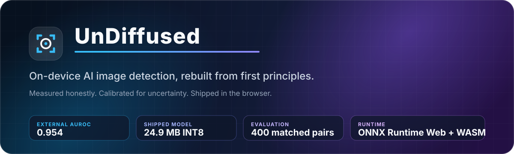
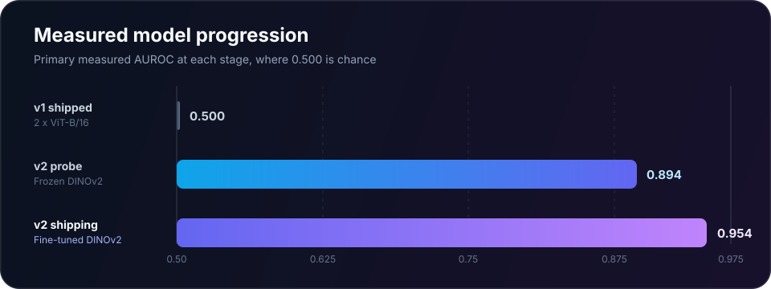
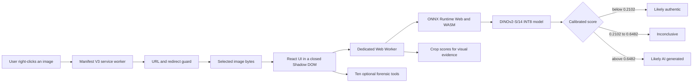

# UnDiffused

<p align="center">
  
</p>

<p align="center">
  <a href="https://github.com/AkshayReddyGujjula/UnDiffused-AI/actions/workflows/ci.yml"></a>
  <a href="LICENSE"></a>
  
  
  
</p>

UnDiffused is a privacy-first Chrome extension for examining whether an image
may be AI generated. It runs a fine-tuned DINOv2 detector locally through ONNX
Runtime Web and backs the verdict with ten interactive forensic tools.

This repository is also the complete engineering record. I measured the model
that the first extension shipped, found that it performed at chance, caught a
replacement learning a dataset shortcut, rebuilt the evaluation around
content-matched pairs, and then solved the model-contract and browser-runtime
failures between a good Python result and a working extension.

> The aim is not to present AI-image detection as solved. The aim is to show how
> I turned an unsupported product claim into a measured, reproducible system
> with explicit limits.

## At a glance

| Shipping result | Measurement |
|---|---:|
| External content-matched AUROC | **0.954** |
| Calibrated expected calibration error | **0.022** |
| Model size | **24.9 MB INT8 ONNX** |
| Compression against FP32 | **3.55x smaller** |
| Warm browser inference | **about 0.7 to 0.9 seconds** |
| External evaluation set | **400 pairs, 800 images** |
| Laundering sweep | **0.948 to 0.958 AUROC** |

The shipping claims come from
[`v2_finetuned_results.json`](docs/benchmark/v2_finetuned_results.json) and
[`v2_finetuned_calibration.json`](docs/benchmark/v2_finetuned_calibration.json).
The evaluation set was not used for training or threshold fitting.

<p align="center">
  
</p>

| Stage | Model | Honest test AUROC | What changed |
|---|---|---:|---|
| v1, measured after shipping | Two ViT-B/16 checkpoints, 174 MB | **0.500** | Established that the original system carried no useful signal |
| v2 probe | Frozen DINOv2-S/14 and linear head | **0.894** | Removed the content shortcut with pair-safe, matched training |
| v2, shipping | Fine-tuned DINOv2-S/14, 24.9 MB | **0.954** | Unfroze the last four blocks, calibrated the score and verified the browser path |

## Why the evaluation changed

The first DINOv2 rebuild appeared to score **0.990 AUROC** on a generator held
out from training. That result was misleading. Real photographs came from COCO,
while generated images came from ELSA prompts derived from LAION. The model
could distinguish the two source corpora without learning authenticity.

On content-matched pairs, the same shortcut model fell to **0.659 AUROC**. Each
matched pair uses a LAION source image and an ELSA generation made from that
image's own caption, so the subject is held approximately constant while the
authenticity label changes. Training on those pairs closed the unmatched to
matched gap from roughly 0.32 to less than 0.01.

That failure shaped the project more than any model choice. A held-out generator
does not protect an evaluation if the corpus seam remains visible.

Read the full account in [Engineering journey](docs/ENGINEERING_JOURNEY.md) and
the final evidence in [Model card](docs/MODEL_CARD.md).

## System architecture



One whole-image forward pass determines the verdict. Additional crop batches
produce explanatory heatmap evidence only; they do not vote on or alter the
classification. Deep Scan changes the evidence tiling, not the verdict model.

The detector contract is asserted before inference:

```text
input       pixel_values, float32 [batch, 3, 224, 224]
normalise   ImageNet mean and standard deviation
output      logits, float32 [batch]
probability sigmoid(logit / 1.9077)
verdict     likely authentic | inconclusive | likely AI generated
```

The architecture, execution boundaries and failure behaviour are documented in
[Architecture](docs/ARCHITECTURE.md). The reasons behind the major choices are
recorded in [Engineering decisions](docs/DECISIONS.md).

## Product surface

The extension supports two ways to start a scan:

- right-click any image and choose **Scan with UnDiffused**;
- choose a local image from the extension popup.

The result panel shows the calibrated three-state verdict, model timing and
crop-based evidence. The forensic workspace then provides:

| Signal family | Tools |
|---|---|
| Compression | Error level analysis, JPEG block analysis |
| Sensor and noise | Noise pattern, PRNU-style residuals |
| Structure | Clone detection, luminance gradients, frequency-domain FFT |
| Optics and lighting | Chromatic aberration, specular highlights |
| File evidence | Metadata and EXIF inspection |

These tools are visual aids, not independent authenticity classifiers. Their
outputs should be interpreted alongside the model result and image context.

## Install locally

### Prerequisites

- Git and [Git LFS](https://git-lfs.com/)
- Node.js and npm
- Google Chrome or another Chromium browser with extension developer mode

### Build and load

```bash
git clone https://github.com/AkshayReddyGujjula/UnDiffused-AI.git
cd UnDiffused-AI
git lfs install
git lfs pull
npm ci
npm run build
```

Open `chrome://extensions`, enable **Developer mode**, choose **Load unpacked**
and select the generated `dist/` directory. Right-click an image and choose
**Scan with UnDiffused**.

The model and WASM files are large Git LFS objects. If the extension cannot
load the model after cloning, run `git lfs pull` and rebuild.

## Verify the repository

```bash
npm test
npm run build
npm run verify:repo
npm audit --audit-level=low
git lfs fsck
```

The test suite pins the model parser, calibration divisor, abstention thresholds,
non-finite output handling and private-address protections. The repository check
validates JSON, local Markdown links and the no-Unicode-dash writing rule. CI
runs the same core checks on every pull request.

To reproduce the ML pipeline, start with the
[Training guide](docs/TRAINING_GUIDE.md). The shipping evaluation contract is in
[Benchmark protocol v2](docs/benchmark/PROTOCOL_V2.md); the original
[`PROTOCOL.md`](docs/benchmark/PROTOCOL.md) remains the historical v1 audit.

## Documentation

| Document | What it answers |
|---|---|
| [Architecture](docs/ARCHITECTURE.md) | How the extension, worker, model, security boundaries and forensic tools fit together |
| [Model card](docs/MODEL_CARD.md) | What was trained, how it was evaluated, what the numbers mean and where they stop applying |
| [Engineering journey](docs/ENGINEERING_JOURNEY.md) | How the project moved from the February prototype to the measured September rebuild |
| [Engineering decisions](docs/DECISIONS.md) | Why I chose local inference, matched pairs, abstention, DINOv2 and browser-safe quantisation |
| [Training guide](docs/TRAINING_GUIDE.md) | How to rebuild, export, score and calibrate the detector |
| [Benchmark protocol v2](docs/benchmark/PROTOCOL_V2.md) | The fixed content-matched, laundering and calibration protocol for the shipping detector |
| [Security policy](SECURITY.md) | Threat model summary, supported code and private reporting route |
| [Contributing](CONTRIBUTING.md) | Setup, evidence standards, style rules and pull request checklist |
| [Changelog](CHANGELOG.md) | The notable public milestones |

## Repository map

```text
src/background/              privileged image retrieval and URL admission control
src/content/                 injected scanner UI and isolated Shadow DOM
src/content/inference/       runtime contract, crop selection, worker and ONNX path
src/components/tools/        ten client-side forensic tools
scripts/bench/               datasets, confound probes, laundering and scoring
scripts/train/               DINOv2 fine-tuning, ONNX export and calibration
scripts/verify/              browser-runtime and repository integrity checks
docs/benchmark/              manifests, protocols and machine-readable evidence
public/models/               the shipping INT8 detector and generated metadata
public/wasm/                 pinned ONNX Runtime Web binaries
tests/                       contract and security regression tests
```

## Privacy and security

Inference is local. The selected image, model score and verdict are not uploaded
to a remote inference service, and the extension has no telemetry or analytics.

For a remote image, the background service worker may fetch the selected source
URL because page-level CORS rules can block direct access. That privileged path
omits credentials, rejects private, loopback, link-local, CGNAT and cloud
metadata destinations, and validates the final URL after redirects before
reading the response body. The result UI runs in a closed Shadow DOM so page
scripts cannot inspect it through `element.shadowRoot`.

The optional Google Lens action opens an external Google endpoint with the
selected image URL. It is separate from model inference and only runs after the
user chooses it.

See [Security policy](SECURITY.md) for the full trust-boundary summary and
responsible disclosure route.

## Known limits

AI-image detection is an open research problem. This project measures one model
against one deliberately controlled protocol; it does not establish universal
performance.

- The external set contains 400 matched pairs from LAION and ELSA_D3 across four
  open-source diffusion families. It does not cover Midjourney, Firefly,
  autoregressive generators or future model families.
- LAION source images are web images, not a verified photography-only corpus.
  Some are graphics, product renders or screenshots.
- The external abstention rate is 14.25%. Among decided images, the measured
  false-positive rate is 6.88% and true-positive rate is 93.77%.
- Cold model loading depends on the browser cache and hardware. The measured
  0.7 to 0.9 second figure is warm single-image inference, not first load.
- The system does not yet verify C2PA provenance. Deterministic provenance
  should take priority wherever it is available.
- The archived v1 checkpoints are retained for reproducibility but have unknown
  provenance and are not part of the shipping extension.

## Project principles

1. **Measure the exact artefact that ships.** Framework accuracy is not browser
   accuracy.
2. **Keep the clean evaluation set clean.** Thresholds are fitted on validation,
   then reported once on external data.
3. **Fail loudly at system boundaries.** A mismatched tensor or non-finite logit
   is an error, not a confidence score.
4. **Say inconclusive when the evidence is weak.** A forced binary answer would
   make the interface look simpler and the result less honest.
5. **Publish negative findings.** The v1 failure and shortcut result are part of
   the work, not details to hide.

## Licence and attribution

Copyright 2026 Akshay Reddy Gujjula. Source code is licensed under the
[Apache License 2.0](LICENSE).

The detector derives from Apache-2.0-licensed DINOv2 weights. JavaScript and
Python dependencies retain their own licences. Dataset bytes are not committed;
versioned manifests record source URLs and SHA-256 hashes. See
[Third-party notices](THIRD_PARTY_NOTICES.md) for the exact boundaries.

If you use this repository in academic or technical work, citation metadata is
available in [`CITATION.cff`](CITATION.cff).
