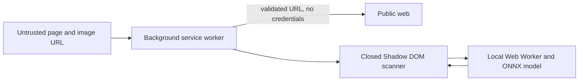

# Security policy

## Supported code

Security fixes target the current `main` branch. The archived v1 checkpoints are
kept for historical reproducibility and are not a supported detector release.

## Report a vulnerability privately

Please use a
[GitHub private security advisory](https://github.com/AkshayReddyGujjula/UnDiffused-AI/security/advisories/new)
for vulnerabilities involving privileged image retrieval, extension messaging,
page isolation, model or WASM loading, local file handling, or dependency supply
chain risk.

Include:

- the affected file, component and browser version;
- a minimal reproduction;
- the security impact;
- whether user interaction is required;
- any suggested mitigation;
- only non-sensitive sample data.

Please do not publish an exploit before a fix or mitigation can be assessed.

## Security model

UnDiffused injects a scanner into untrusted web pages. The background service
worker has broad HTTP and HTTPS host access so it can retrieve an image when page
CORS rules block direct canvas access. This makes the background fetch path the
main privileged boundary.

### Current controls

- message senders must match the extension runtime identity;
- content injection and scan delivery target the top frame;
- privileged fetches omit cookies and HTTP authentication credentials;
- non-HTTP schemes are rejected except local `data:` and `blob:` image paths;
- literal loopback, private, link-local, CGNAT, cloud metadata, alternate IPv4
  and reserved IPv6 destinations are rejected;
- a final redirect destination is checked before the body is read;
- the injected React UI uses a closed Shadow DOM;
- model tensor names, output shape, length, temperature and finite logits are
  validated before a verdict is shown;
- no telemetry, analytics, account system or remote inference backend exists in
  the source tree.

The URL-guard regression cases are in
[`tests/urlguard.test.mjs`](tests/urlguard.test.mjs). The model boundary tests are
in [`tests/parse.test.mjs`](tests/parse.test.mjs).

## Network behaviour

Model inference and forensic processing run on the user's device. The model,
score and verdict are not uploaded to a remote inference service.

Two user flows can use the network:

1. A remote image may be retrieved from its selected source URL by the
   background worker.
2. The optional Google Lens action opens a Google endpoint and can pass the
   selected remote image URL.

These are separate from inference and should remain explicit in user-facing
privacy wording.

## Known residual risks

The current controls do not remove every risk:

- URL admission is based on parsed host literals and does not resolve DNS before
  fetch, so a public hostname resolving to a private address is not covered.
- A redirect to a blocked destination is detected before its response body is
  read, but the redirected request may already have been sent by the browser.
- Response size, fetch duration, MIME type and decoded image dimensions are not
  explicitly capped before full in-memory processing.
- `data:` and `blob:` inputs are admitted by scheme rather than an independent
  MIME gate.
- Rejecting a timed-out inference promise does not terminate the underlying
  worker job.
- A hostile public image can still target browser decoder or resource-exhaustion
  behaviour.
- Git LFS and npm dependencies remain supply-chain inputs and need review when
  updated.

These are documented engineering limits, not guarantees that an exploit exists.
Reports with a concrete reproduction are especially useful.

## Out of scope for security reports

The following are model-quality or research limitations unless they demonstrate
a separate security impact:

- a genuine image receiving a generated verdict;
- a generated image receiving an authentic verdict;
- poor performance on an untested generator;
- disagreement with a forensic visualisation;
- loss of accuracy after distribution shift;
- absence of C2PA support.

Model-quality issues are still welcome as ordinary bug reports when they include
reproducible, redistributable evidence.

## Disclosure process

Reports will be acknowledged through the advisory thread. The project will
assess scope, reproduce the issue where possible, prepare a minimal fix and add
a regression test. Credit will be offered in the security advisory unless the
reporter prefers to remain anonymous.
