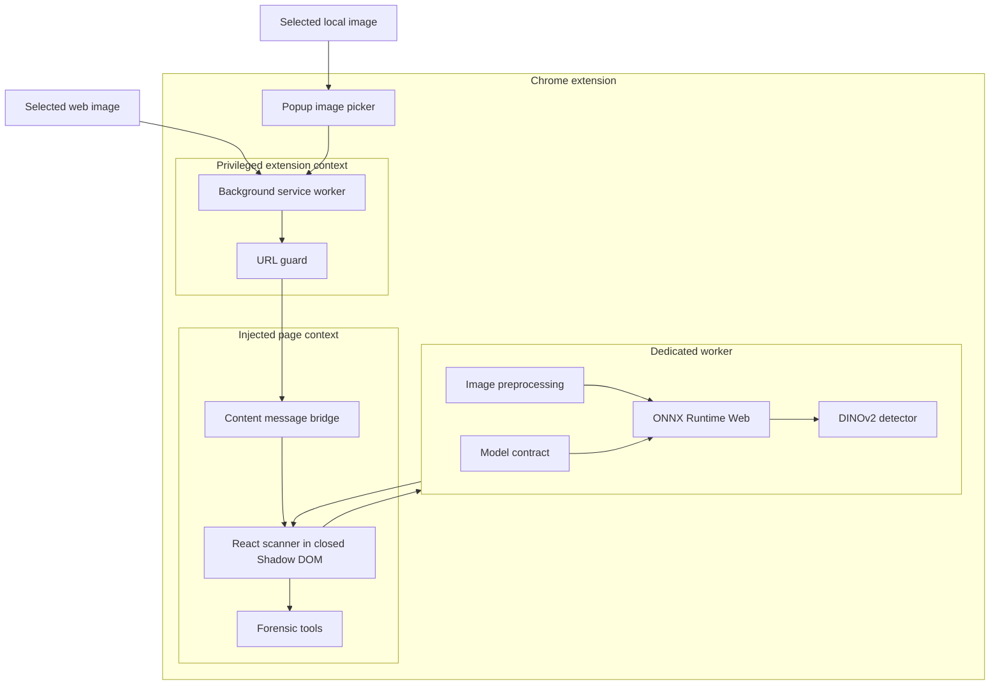
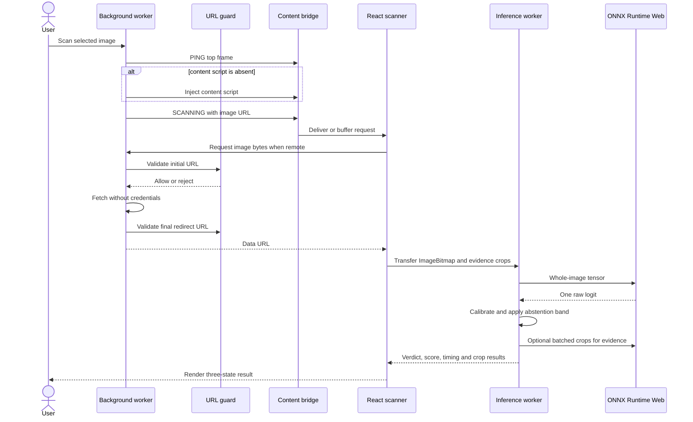
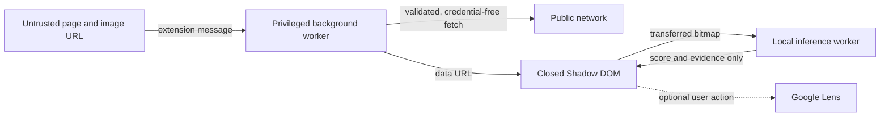
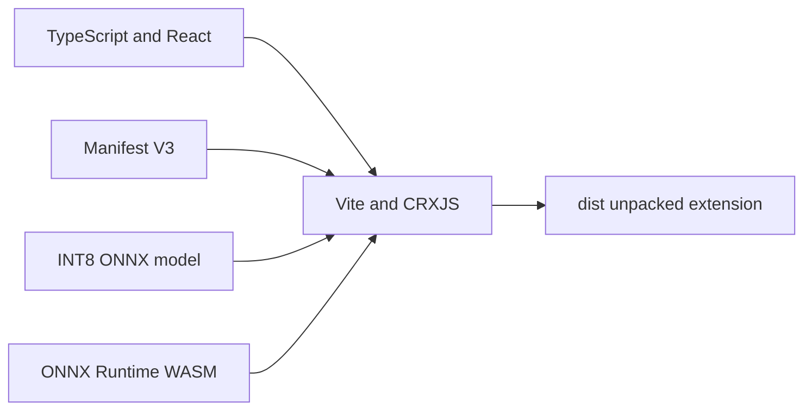

# UnDiffused architecture

> Status: shipping architecture on `main`
>
> Runtime: Chrome Manifest V3, React, TypeScript, Web Workers, ONNX Runtime Web
> Model: fine-tuned DINOv2-S/14, dynamically quantised ONNX

This document explains how a scan moves through the extension, where privileged
work happens, how the model contract is enforced and which components are
allowed to influence the verdict.

## 1. Design goals

UnDiffused is built around five constraints:

1. **Keep inference local.** Images, scores and verdicts should not be sent to a
   hosted inference API.
2. **Keep the browser responsive.** Model loading, preprocessing and inference
   run outside the page's main thread.
3. **Make uncertainty visible.** The UI must support an inconclusive result
   instead of forcing a binary answer.
4. **Treat model boundaries as typed interfaces.** Tensor names, ranks, output
   lengths and finite values are asserted before a score reaches the UI.
5. **Separate verdicts from supporting evidence.** One whole-image pass decides
   the result. Crop maps and forensic tools provide context but cannot silently
   change it.

The project deliberately does not claim universal detection, deterministic
provenance or validated forensic attribution. Those are separate problems.

## 2. Component topology



### Components and responsibilities

| Component | Responsibility | Main files |
|---|---|---|
| Manifest | Declares entry points, permissions, content scripts and packaged runtime assets | [`manifest.json`](../manifest.json) |
| Background service worker | Creates the context menu, injects the content script when needed, retrieves remote image bytes and routes popup scans | [`src/background/main.ts`](../src/background/main.ts) |
| URL guard | Rejects disallowed schemes and literal private, loopback, link-local, CGNAT, metadata and reserved destinations | [`src/background/urlGuard.ts`](../src/background/urlGuard.ts) |
| Content bridge | Receives extension messages before React mounts and buffers an early scan request | [`src/content/index.tsx`](../src/content/index.tsx), [`src/content/ready.ts`](../src/content/ready.ts) |
| Scanner UI | Owns scan state, image acquisition, dragging, results, deep-scan progress and error handling | [`src/content/Scanner.tsx`](../src/content/Scanner.tsx) |
| Inference coordinator | Chooses crops, transfers the bitmap, correlates requests and enforces timeouts | [`src/content/inference/pipeline.ts`](../src/content/inference/pipeline.ts) |
| Inference worker | Loads ONNX Runtime Web, preprocesses images, runs the detector and returns verdict plus evidence | [`src/content/inference/worker.ts`](../src/content/inference/worker.ts) |
| Model contract | Binds tensor names, shapes, temperature, thresholds and parsing rules to the shipping model | [`src/content/inference/contract.ts`](../src/content/inference/contract.ts) |
| Result surface | Renders the three-state verdict, timing, evidence overlay and optional external actions | [`src/components/ResultView.tsx`](../src/components/ResultView.tsx) |
| Forensic workspace | Runs ten canvas-based investigative tools and exports their output | [`src/components/ForensicToolsPanel.tsx`](../src/components/ForensicToolsPanel.tsx) |

## 3. Scan sequence



### Starting a scan

A scan starts from either the image context menu or the popup file picker. The
background worker always targets frame `0`, preventing an iframe response from
winning the race. If the content script is missing, it is injected on demand.

The content listener is registered at module scope before React mounts. The
bridge stores one pending request and replays it after the scanner registers its
handler. This replaced polling, which could deadlock when an iframe answered a
readiness check without mounting the application.

### Acquiring the image

The scanner first looks for a better source in `srcset`, common lazy-loading
attributes or a direct image link. Local `data:` and `blob:` sources can be
decoded in place. A remote HTTP image is fetched by the background worker because
page-level CORS rules can otherwise prevent canvas access.

That remote retrieval is the architecture's main privileged boundary. The
initial URL is checked before the fetch, credentials are omitted, and the final
redirect destination is checked before the response body is read.

### Moving work off the page thread

The decoded `ImageBitmap` is transferred, not copied, into one inline Web Worker.
The main page remains available for rendering and interaction while the worker
runs image preprocessing and ONNX inference. Requests use UUIDs, a 30-second
promise timeout and a single serial worker queue.

## 4. Inference path

### Shipping model

The model is a DINOv2-S/14 image encoder with:

- mean pooling over patch tokens, excluding the CLS token;
- the final four transformer blocks unfrozen during fine-tuning;
- dropout and one binary logit head;
- binary cross-entropy training where label `1` means generated;
- dynamic INT8 quantisation for MatMul operators only.

The output has one semantic direction by construction: a higher logit means a
higher estimated probability that the image is generated. This avoids the
unrecorded class-index problem in v1.

### Preprocessing contract

| Field | Shipping value |
|---|---|
| Input name | `pixel_values` |
| Input shape | `[batch, 3, 224, 224]` |
| Input type | `float32` |
| Resize | Canvas draw to 224 by 224 RGB |
| Channel layout | NCHW |
| Mean | `[0.485, 0.456, 0.406]` |
| Standard deviation | `[0.229, 0.224, 0.225]` |
| Output name | `logits` |
| Output shape | `[batch]` |
| Output meaning | one raw binary logit per image |

ONNX Runtime Web uses WASM, SIMD, one thread and full graph optimisation. The
four packaged WASM variants let the runtime choose the supported execution path.

### Contract enforcement

The runtime checks input and output names when the session loads. The first
output then confirms the expected arity, rank and buffer length. Parsing rejects
non-finite logits and invalid temperatures instead of allowing `NaN`, `Infinity`
or a mismatched tensor to become a convincing percentage.

The contract values are deliberately bound to the selected model. The current
fine-tuned graph emits a raw logit and therefore uses temperature `1.9077`. The
older probe folded temperature scaling into the graph and required `1.0` at
runtime. Keeping this value beside the model definition prevents a model swap
from silently applying calibration twice.

### Calibrated three-state decision

The probability is:

```text
P(AI) = sigmoid(logit / 1.9077)
```

| Calibrated probability | Verdict |
|---:|---|
| below `0.2102` | likely authentic |
| `0.2102` to `0.6482` | inconclusive |
| above `0.6482` | likely AI generated |

The band was selected on the training run's validation split against a 5% target
false-positive rate and a 25% maximum abstention ceiling. The external result is
reported without moving those thresholds: 14.25% abstention, 6.88% false
positives on decided authentic images and 93.77% true positives on decided
generated images.

## 5. Verdict and evidence are separate

One whole-image forward pass determines the verdict. This is the only score
passed through the calibrated three-state policy.

Default mode also calculates a saliency-style quality map and selects up to nine
adaptive crops. Deep Scan instead divides the image into non-overlapping
224-pixel tiles. Those crops are sent through the same model in batches and
returned as evidence for the visual overlay.

The crop outputs are not independently calibrated and do not change the
whole-image verdict. The overlay is therefore a regional score view, not a
causal explanation or a second classifier. This distinction matters because the
model was trained on whole images and a crop can be outside that distribution.

## 6. Forensic workspace

The forensic tools are local canvas operations that help a user inspect a
result. They are not trained detectors and do not contribute to the model score.

| Tool | Technique | Output |
|---|---|---|
| Error level analysis | JPEG recompression difference | Regions with different recompression behaviour |
| Noise pattern | Laplacian residual statistics | Spatial noise variation |
| Clone detection | Quantised patch descriptors | Similar regions within one image |
| Frequency domain | Two-dimensional FFT | Repeated or grid-like frequency structure |
| Luminance gradient | Sobel, Canny and Laplacian operators | Edge and texture structure |
| PRNU-style analysis | Signal-normalised residual | Single-image sensor-noise approximation |
| Specular highlights | Highlight direction heuristics | Lighting consistency hints |
| Chromatic aberration | Channel-edge displacement | Colour fringing around strong edges |
| Compression artefacts | 8 by 8 DCT residuals | JPEG block behaviour |
| Metadata | JPEG EXIF, IPTC and XMP parsing | Embedded file metadata |

The panel keeps a reusable data URL, creates result canvases, offers a comparison
slider and exports a selected visualisation as PNG. The PRNU view explicitly
states that it cannot identify a camera model from one image.

## 7. Trust boundaries and data handling



| Boundary | Control | Residual risk |
|---|---|---|
| Page to extension message | Sender identity checks and typed message validation | A page can still present a hostile or very large public image |
| URL to privileged fetch | Scheme and literal-address guard, no credentials, final redirect check | DNS rebinding is not resolved before fetch; a blocked redirect request may already have been issued |
| Response to memory | Body is read only after final URL validation | No explicit byte, time, content-type or decoded-dimension limit exists yet |
| Page to result UI | Closed Shadow DOM | The page still controls surrounding layout and selected source URL |
| UI to external search | Explicit user action | Google Lens receives the selected remote image URL when this option is used |

There is no application backend, account system, telemetry pipeline, analytics
SDK or remote inference endpoint in the source tree.

## 8. Failure behaviour

| Failure | Behaviour |
|---|---|
| Content script absent | Background worker injects it and retries |
| Scan arrives before React | Content bridge buffers it until mount |
| URL is private or disallowed | Fetch is rejected before reading a body |
| Model tensor contract differs | Initialisation fails with a contract error |
| Output is non-finite or wrong length | Result is rejected and rendered as an error |
| Adaptive crop selection returns none | Coordinator falls back to a fixed grid |
| Individual evidence crop fails | Whole-image verdict remains valid; missing crop is omitted |
| Request exceeds 30 seconds | Caller rejects the pending promise |
| New scan supersedes an old scan | Scan token prevents the stale result from replacing the new one |

The 30-second timeout does not currently cancel computation inside the worker.
An orphaned task may continue and delay the serial queue. This is recorded as an
open availability limitation rather than hidden behind the UI.

## 9. Build and packaging

Vite and `@crxjs/vite-plugin` compile the three extension entry points and inline
the inference worker. TypeScript is checked before the production bundle is
built. The model and ONNX Runtime WASM binaries are copied from `public/` and
tracked through Git LFS.



The browser is part of the deployment target, not just a display layer. An ONNX
export is not accepted because Python can load it; it must also use operators
implemented by the browser WASM backend and pass the real TypeScript parser.

## 10. Verification layers

| Layer | What is checked | Evidence |
|---|---|---|
| Unit and regression | Parser arity, class handling, finite values, calibration, thresholds and URL guard cases | [`tests/`](../tests) |
| Type and bundle | TypeScript compilation and production extension build | `npm run build` |
| Repository integrity | JSON parsing, Markdown links and prohibited Unicode dash characters | `npm run verify:repo` |
| Framework to ONNX | FP32 output divergence against PyTorch | [`detector_v2_finetuned_meta.json`](../public/models/detector_v2_finetuned_meta.json) |
| Shipping model quality | Exact INT8 file under content matching and laundering | [`v2_finetuned_results.json`](benchmark/v2_finetuned_results.json) |
| Calibration policy | Temperature, thresholds and untouched external check | [`v2_finetuned_calibration.json`](benchmark/v2_finetuned_calibration.json) |
| Large-file integrity | Git LFS object availability | `git lfs fsck` |

The browser harness is a runtime smoke test, not an accuracy benchmark. It also
requires generated local cases, so it is intentionally documented as a manual
verification step in [Reproducibility](REPRODUCIBILITY.md).

## 11. Current architecture limits

- Hostname checks do not perform DNS resolution before a privileged fetch.
- Image responses have no explicit byte, time, MIME or decoded-dimension cap.
- Runtime contract values are repeated in a small number of files; metadata is
  generated from export but is not read dynamically by the extension.
- The worker timeout rejects the caller but does not cancel the running job.
- The regional crop display is supporting evidence, not a validated attribution
  method.
- The forensic tools use hand-built heuristics and do not have benchmarked error
  rates.
- C2PA and other deterministic provenance checks are not implemented.

These limits are candidates for future work, not reasons to broaden the current
claims.

## 12. Related documents

- [Model card](MODEL_CARD.md)
- [Engineering decisions](DECISIONS.md)
- [Engineering journey](ENGINEERING_JOURNEY.md)
- [Reproducibility](REPRODUCIBILITY.md)
- [Benchmark protocol v2](benchmark/PROTOCOL_V2.md)
- [Security policy](../SECURITY.md)
